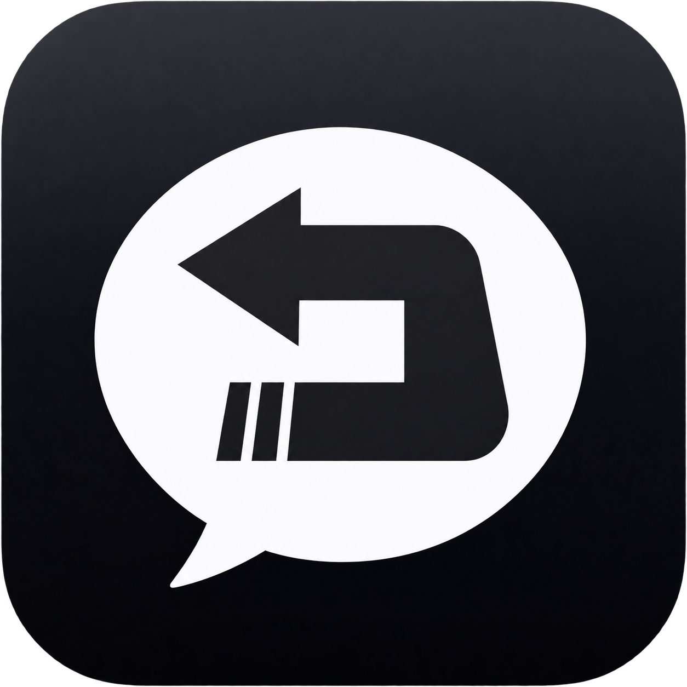
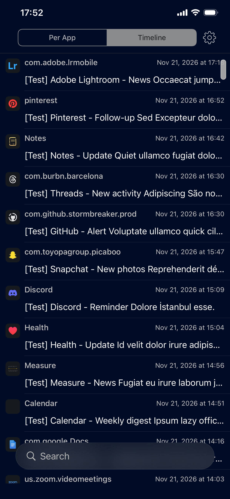
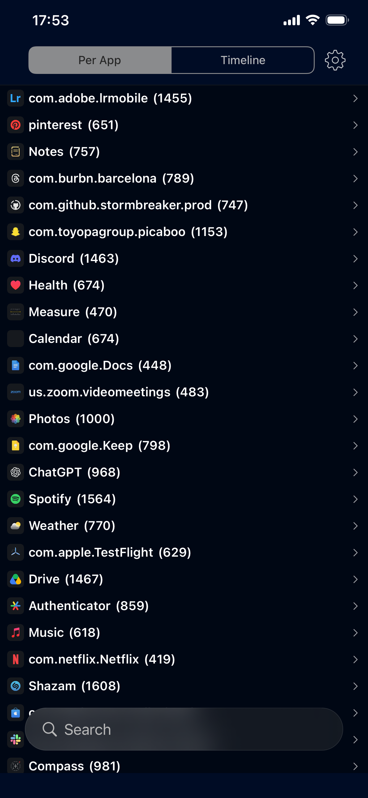
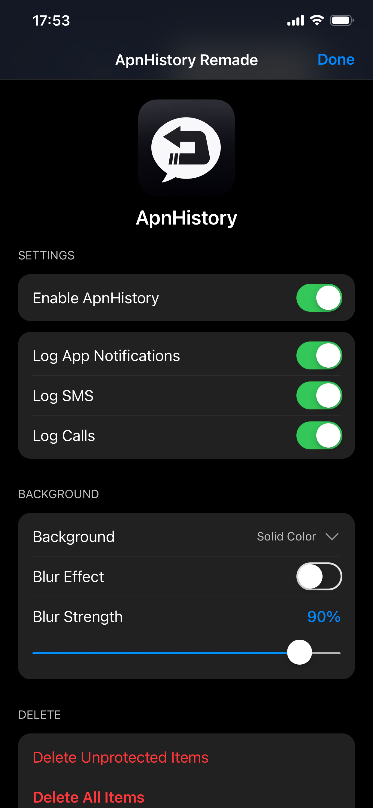
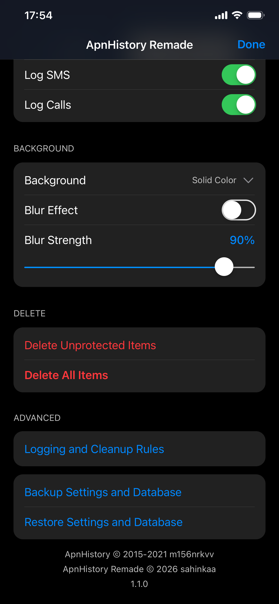
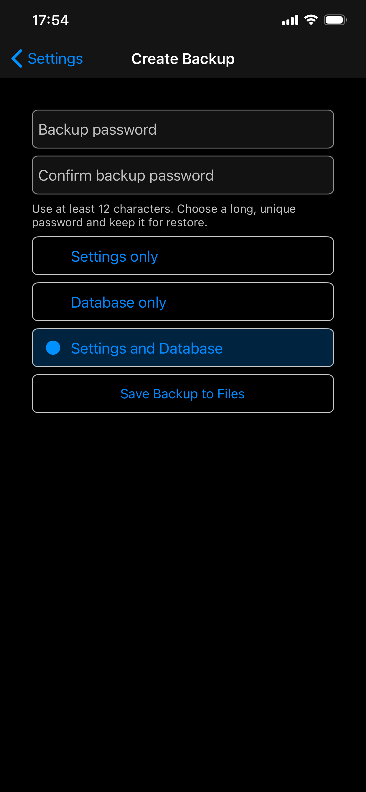
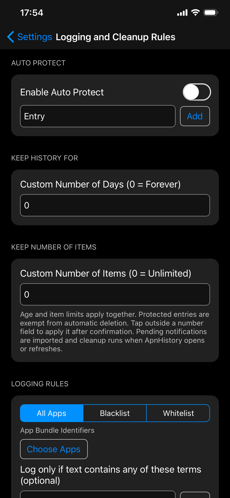
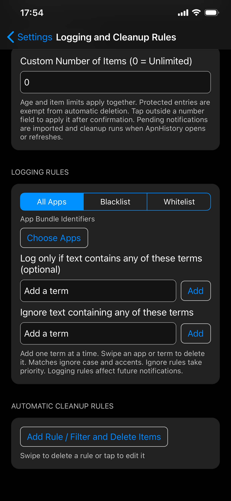
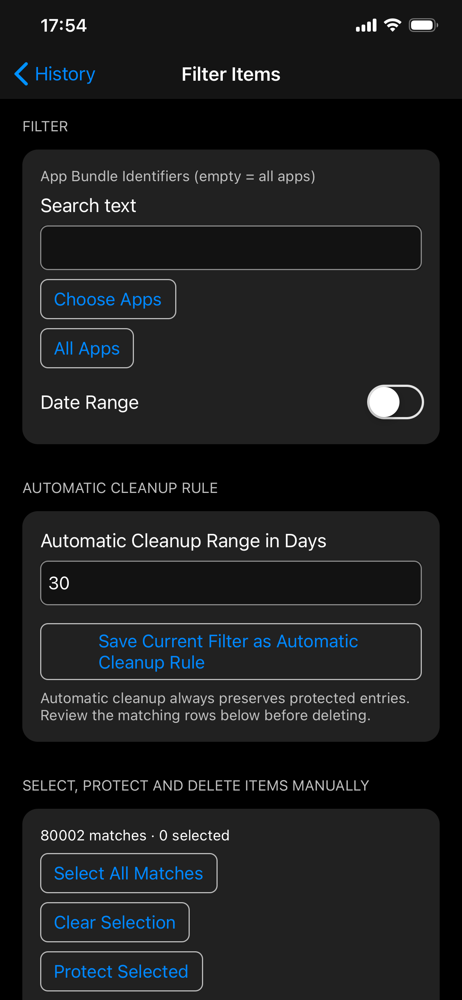
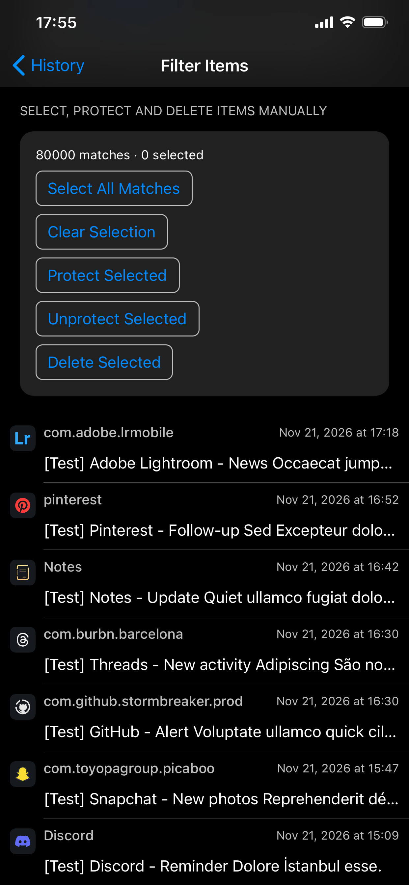

# ApnHistory Remade

I've been using ApnHistory since the dawn of time. I couldn't go without it on iOS 26, so I remade it. Thank you to **m156nrkvv** for making the original and giving me a tweak I've kept coming back to for years.

ApnHistory Remade keeps a local history of app notifications, incoming SMS and calls. Browse it by app or in a timeline and search as you type in either view. Use **Copy notification** from an entry’s menu to put its text on the clipboard.

Keep track of notifications from apps whose alerts you’ve turned off, whenever iOS still posts those notifications as system bulletins. Turning off delivery can prevent a notification from reaching the capture hook.

## What's changed from the original

- Reworked notification capture around the SpringBoard bulletin observation method used by **Vē Enhanced**.
- Rebuilt Settings for light and dark mode and added a color picker and photo backgrounds with adjustable blur.
- Added **Copy notification** alongside **View raw data** and restored app icons and app launching from history.
- Added live search and collapsible Per App groups with item counts that update as you search.
- Expanded Auto Protect to an editable list of keywords. Choose a history limit or enter 0 for unlimited storage. New entries replace the oldest unprotected items as the history fills.
- Added separate controls to delete unprotected items or clear the entire history. Individual entries can be deleted with a swipe.
- Removed Twitter media saving and the Extended Scheme option.

## Compatibility and installation

The packages target **iOS 15 through iOS 26**. Navigation, live search, backup and restore performed well with **80,000 history items** on an **iPhone 8 Plus** running iOS 16.6 and an **iPhone 11 Pro Max** running iOS 26.0.1, both with Dopamine RootHide. iOS 15 and rootless runtime behavior still need device testing. Choose the .deb for your jailbreak from [the latest release](https://github.com/sahinkaa/ApnHistoryRemade/releases/latest) and open it in Sileo. Rootless uses `iphoneos-arm64`. RootHide uses `iphoneos-arm64e`. The Home Screen label is **ApnHistory**.

## Screenshots

  
  
  

  
  
  

  
  
  

## Credits

Original **ApnHistory** by **m156nrkvv**. Remade by **sahinkaa**. Credit to **Vē Enhanced** for the notification capture method.
